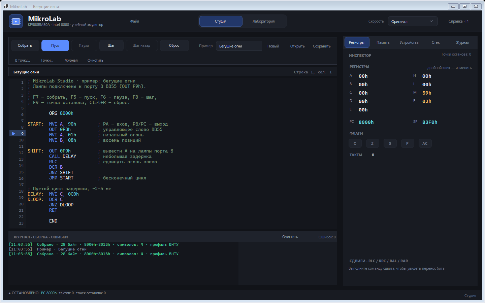
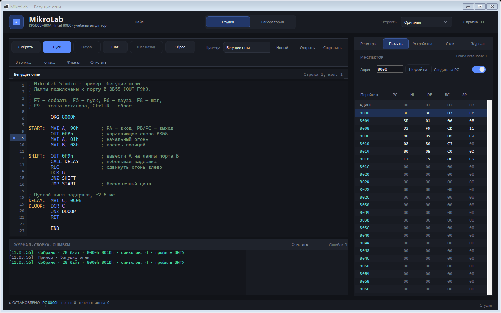
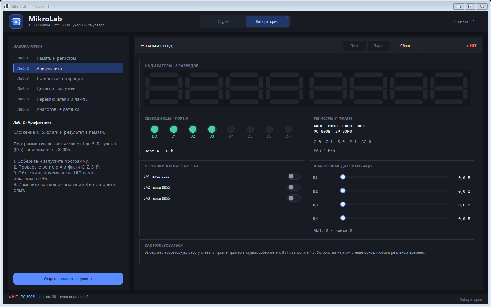
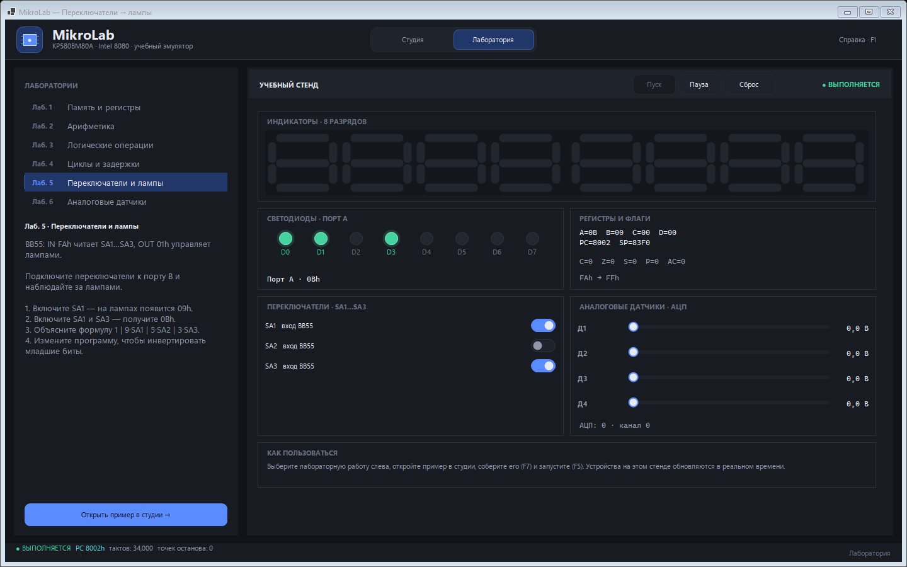

# MikroLab

**MikroLab** — учебный эмулятор КР580ВМ80А (Intel 8080) для Windows, Linux и macOS
с современным интерфейсом и двумя рабочими областями: полноценной студией
разработчика и наглядным лабораторным стендом. В репозитории есть
кроссплатформенный консольный инструмент для сборки, запуска и конвертации
программ без графической оболочки.

Проект написан как самостоятельное приложение с собственной историей и не является
форком. Часть ядра и модели устройств восходит к открытому GPLv3-проекту
[ZeeWanderer/Emulator](https://github.com/ZeeWanderer/Emulator); подробности — в
[THIRD-PARTY-NOTICES.md](THIRD-PARTY-NOTICES.md).



## Возможности

### Студия

- **трехпанельная компоновка**: инспектор (регистры, устройства, стек, журнал) слева, редактор кода по центру, интерактивная лента ячеек памяти (ОЗУ 64 КиБ) справа;
- редактор исходного кода с подсветкой, номерами строк и точками останова;
- двухпроходный ассемблер Intel 8080 с директивами `ORG`, `EQU`, `DB`, `DW`, `DS`;
- сборка по **F7**, пуск (**F5**), пауза (**F6**), пошаговое выполнение (**F8** / **F10**) и сброс (**Ctrl+R**);
- инспектор с регистрами, флагами, счётчиком тактов и стеком вызовов;
- редактирование регистров двойным кликом: `A`…`L`, `F`, `M`, `PC`, `SP`
  с проверкой диапазона и корректным обновлением флагов;
- постоянная визуализация всех 64 КиБ памяти на правой панели: переход по адресу, следование за `PC`,
  шестнадцатеричный и ASCII просмотр, редактирование ячеек двойным кликом и панель быстрого ввода (`00H`, `FFH`, `+1`, `-1`, `NOP`);
- двойной профиль ядра процессора: быстрое переключение между **Legacy** (лабораторные 1–4, воспроизведение
  аппаратных особенностей учебного стенда) и **Newest** (лабораторная 5+, полный набор 256 инструкций i8080, 2.0 МГц);
- управление скоростью выполнения: от темпа оригинала до максимума и фиксированных
  значений от 100 000 до 10 команд в секунду;
- импорт и экспорт **Intel HEX**, снимков **.580**, сырых **BIN**-образов,
  сохранение и загрузка полного состояния машины;
- профили памяти **ВНТУ** (`8000h`/`83F0h`) и **УМК** (`0800h`/`0FFFh`) с
  настраиваемыми ORG, начальным PC и SP;
- панель устройств: семисегментные индикаторы, светодиоды, переключатели,
  АЦП и матричная клавиатура 4×4 на порту C;
- журнал сборки и список ошибок с переходом к нужной строке;
- готовые примеры, включая пример для профиля УМК, и шаблон нового проекта,
  открытие и сохранение `.asm`;
- отладчик: точки останова по строке и адресу, наблюдение чтения/записи памяти,
  выполнение до адреса, шаг назад и журнал выполнения с экспортом в CSV/Markdown;
- замедленная анимация сдвигов `RLC`/`RRC`/`RAL`/`RAR` в инспекторе регистров.


*Инспектор устройств в Студии: адаптер КР580ВВ55А, 8-разрядный семисегментный индикатор, светодиоды, переключатели, аналоговые датчики АЦП и матричная клавиатура*

### Лаборатория

- семь учебных работ с описанием, порядком выполнения и привязкой к примеру;
- единый аппаратный стенд: индикаторы, лампы, тумблеры SA1…SA3, аналоговые
  датчики, АЦП и матричная клавиатура 4×4;
- живое обновление всех приборов во время выполнения программы;
- эталонные результаты `A`, `DE` и ячеек памяти для детерминированных работ
  и автоматическая проверка после останова по `HLT` (кнопка «Проверить»
  работает и в ручной паузе);
- кнопка перехода из лабораторной работы прямо в студию;
- общая машина для обеих областей: программа, запущенная в студии, продолжает
  работать на стенде.


*Классический лабораторный стенд с описанием работы, эталонами и интерактивными органами управления*


*Интерактивное выполнение лабораторной работы №5 на стенде: опрос тумблеров SA1…SA3 и управление светодиодами порта B в реальном времени*

### Общее

- тёмная тема, высокое DPI, аккуратные настраиваемые элементы управления;
- интерфейс студии в двух оболочках: WinForms на Windows и Avalonia 12 на
  Linux/macOS; обе используют общий слой `MikroLab.Presentation`;
- из NuGet-пакетов используются только `Avalonia`, `Avalonia.Desktop` и
  `Avalonia.Themes.Fluent`; WinForms-сборка обходится стандартным .NET;
- ядро полностью отделено от интерфейса и покрыто тестами;
- кроссплатформенные ядро, презентационный слой, студия, CLI и тесты;
- CI-матрица проверяет сборку на Windows, Linux и macOS;
- встроенный режим снятия скриншотов для документации и регрессий.

## Режимы выполнения процессора: Legacy vs Newest

В MikroLab реализовано чёткое архитектурное разделение на два независимых режима работы процессора — **Legacy** и **Newest**. Это устраняет конфликт между историческими вузовскими лабораторными практикумами и строгим современным стандартом микропроцессора Intel 8080 / КР580ВМ80А:

### 1. Профиль «Legacy» (Лабораторные 1–4)

Разработан специально для академических практикумов (лабораторные работы 1–4 ВНТУ, КФУ и др.), ориентированных на исторический учебный стенд «Микролаб КР580ВМ80А»:
- **Буфер регистров монитора при останове**: по команде `HLT` процессор автоматически сохраняет текущие значения регистров (`L, H, E, D, C, B, PSW, A`) в фиксированную область ОЗУ монитора по адресам `83E4h…83EBh`. Проверочные алгоритмы лабораторных 1–4 считывают результаты именно из этих ячеек.
- **Аппаратные особенности микрокода стенда**: строгое воспроизведение исторического поведения учебного стенда при косвенной адресации и чтении тумблеров через формулу порта `FAh`.
- **Подпрограммы ПЗУ монитора**: доступны стандартные системные вызовы стенда — `0100h` (`SEGGG` — вывод на 7-сегментные индикаторы), `0300h` (`SOUND` — звуковой сигнал) и `0400h` (`DELAY` — миллисекундная задержка по параметрам в ячейках `8000h..8001h`).

### 2. Профиль «Newest / Extended» (Лабораторная 5+ и новые проекты)

Полнофункциональная, строгая спецификация микропроцессора Intel 8080 и адаптера КР580ВВ55А:
- **Полная система команд (все 256 опкодов)**: поддерживаются все команды без исключений — десятичная коррекция `DAA` (двоично-десятичная арифметика BCD), недокументированные `NOP`, операции со стеком `PUSH PSW` / `POP PSW`, инверсия `CMA`, полный набор сдвигов `RLC`, `RRC`, `RAL`, `RAR`.
- **Точное обновление флагов**: расчёт флагов переноса `C`, нуля `Z`, знака `S`, паритета (чётности) `P` и вспомогательного полупереноса тетрады `AC` (Auxiliary Carry).
- **Микросхема параллельного ввода-вывода КР580ВВ55А (i8255 PPI)**: полноценная эмуляция микросхемы со всеми режимами (Mode 0, 1, 2), регистром управляющего слова РУС (`FBh`), портами `FAh` (PA), `F9h` (PB), `F8h` (PC) и побитовым управлением линиями порта C.
- **Тактовая частота 2.0 МГц**: точный темп тактирования (машинный такт 0.5 мкс).

---

### Сравнительная таблица различий

| Характеристика | Профиль `Legacy` (Лаб. 1–4) | Профиль `Newest` (Лаб. 5+) |
|:---|:---|:---|
| **Назначение** | Лабораторные 1–4, воспроизведение старого стенда | Лабораторные 5–7, свободная разработка, полный i8080 |
| **Система команд** | Базовый набор команд учебного стенда | **Все 256 опкодов** Intel 8080 / КР580ВМ80А |
| **Флаги регистра PSW** | Базовые флаги Z, S, C | Полный набор: **Z, S, P, C, AC** |
| **Останов по HLT** | Выгрузка РОН в буфер памяти `83E4h…83EBh` | Корректный останов ЦПУ с сохранением регистров и аппаратного стека |
| **Модель КР580ВВ55А (PPI)** | Упрощённый ввод тумблеров и вывод ламп | Полнофункциональная модель i8255 (режимы 0/1/2, РУС `FBh`, порты A/B/C) |
| **Десятичная коррекция (DAA)** | Не поддерживается | Полная поддержка BCD с полупереносом `AC` |
| **Команды PUSH/POP PSW** | Ограничено | Полная поддержка сохранения и восстановления PSW |
| **Тактирование** | Регулируемый программный темп | Частота 2.0 МГц (такт 0.5 мкс) |

---

### Как переключать профиль

1. **В интерфейсе MikroLab Studio**:
   - В тулбаре слева: выпадающий список **«Режим»** позволяет на лету переключить процессор между `Legacy (Лаб. 1–4)` и `Newest (Лаб. 5+)`.
   - В нижней строке состояния всегда отображается активный режим: `Режим: Newest` или `Режим: Legacy`.
   - При выборе лабораторной работы из встроенного списка среда автоматически выставляет рекомендованный режим.
2. **В командной строке (CLI)**:
   - Флаг `--profile legacy` или `--profile newest` при запуске `run`:
     ```bash
     MikroLab.Cli run my_prog.asm --profile legacy
     MikroLab.Cli run my_prog.asm --profile newest
     ```
3. **В лабораторном практикуме**:
   - Лабораторные работы **№1–4** автоматически выполняются в режиме `Legacy` для точной проверки результатов в буфере памяти.
   - Лабораторные работы **№5–7** (ВВ55А, опрос тумблеров, матричная клавиатура 4×4, АЦП) автоматически запускаются в режиме `Newest`.

## Быстрый старт

Для сборки требуются .NET SDK **10.0.400** или новее (версия зафиксирована в
`global.json`) и Windows 10/11, Linux или macOS 12+.

Windows — полное решение и WinForms-студия:

```powershell
dotnet build MikroLab.sln
dotnet run --project src\MikroLab.App\MikroLab.App.csproj
```

Linux и macOS — кроссплатформенная студия на Avalonia:

```bash
dotnet build src/MikroLab.Avalonia/MikroLab.Avalonia.csproj
dotnet run --project src/MikroLab.Avalonia/MikroLab.Avalonia.csproj
```

Тесты одинаковы на всех платформах:

```bash
dotnet run --project tests/MikroLab.Tests/MikroLab.Tests.csproj
```

На Windows можно открыть `MikroLab.sln` в Visual Studio и запустить
`MikroLab.App`; на Linux/macOS собирайте проект `MikroLab.Avalonia` отдельно —
WinForms-проект в решение входит, но на этих платформах не собирается.

## Релизы

Текущая версия — **1.2.0**. Теги и готовые сборки публикуются на странице
[GitHub Releases](https://github.com/remageht/MikroLab/releases), история
изменений — в [CHANGELOG.md](CHANGELOG.md).

В релиз входят студии для трёх платформ:

- `MikroLab.exe` — Windows-студия (WinForms, self-contained, .NET устанавливать
  не нужно, сжатый single-file образ ~47 МБ);
- `MikroLab-linux-x64.tar.gz`, `MikroLab-linux-arm64.tar.gz` — Linux-студия на
  Avalonia: исполняемый файл `MikroLab`, `LICENSE`, `THIRD-PARTY-NOTICES.md`
  и `README.md`;
- `MikroLab-osx-x64.tar.gz`, `MikroLab-osx-arm64.tar.gz` — macOS-студия в виде
  `MikroLab.app` с теми же документами;
- исходный код и лицензия доступны в репозитории и в архиве тега.

Все сборки self-contained: устанавливать .NET не нужно. CLI в релиз не входит:
`MikroLab.Cli` остаётся инструментом разработки и проверки ядра.

### Портативность

Студия не требует установки, не пишет в реестр и не создаёт файлов настроек.
Windows: скопируйте `MikroLab.exe` в любую папку и запустите. Linux: распакуйте
архив и запустите `./MikroLab`. macOS: распакуйте архив и запустите
`MikroLab.app` (при необходимости — `open MikroLab.app`).

Если приложение аварийно завершится, `crash.log` появится рядом с исполняемым
файлом. Когда каталог доступен только для чтения, лог пишется в пользовательский
каталог данных:

| Платформа | Путь |
|---|---|
| Windows | `%LOCALAPPDATA%\MikroLab\crash.log` |
| Linux | `~/.local/share/MikroLab/crash.log` |
| macOS | `~/Library/Application Support/MikroLab/crash.log` |

Релизные сборки не обфусцированы: из них удалены только отладочные символы
(`.pdb`), а исходный код доступен на условиях GPLv3.

### macOS и Linux

Сборки для macOS не подписаны сертификатом Apple. Если Gatekeeper блокирует
запуск, разрешите приложение один раз:

```bash
xattr -dr com.apple.quarantine MikroLab.app
open MikroLab.app
```

Либо нажмите на `MikroLab.app` правой кнопкой → «Открыть» → «Открыть».
Минимальная версия — macOS 12.

Для Linux нужны обычные библиотеки рабочего стола X11/Wayland и fontconfig
(в минимальных контейнерах их может не быть). На x64-системах используйте
`linux-x64`, на ARM64 (например, Raspberry Pi) — `linux-arm64`.

Обе оболочки — WinForms и Avalonia — используют общий `MikroLab.Presentation`
и `MikroLab.Core`, поэтому форматы файлов, профили, лабораторные работы,
отладчик и горячие клавиши совпадают.

### CLI для разработки

`MikroLab.Core`, `MikroLab.Presentation`, `MikroLab.Avalonia`, `MikroLab.Cli`
и тесты не зависят от WinForms и собираются кроссплатформенно. CLI не
публикуется в релизах:

```bash
dotnet build src/MikroLab.Core/MikroLab.Core.csproj
dotnet build src/MikroLab.Presentation/MikroLab.Presentation.csproj
dotnet build src/MikroLab.Avalonia/MikroLab.Avalonia.csproj
dotnet build src/MikroLab.Cli/MikroLab.Cli.csproj
dotnet run --project tests/MikroLab.Tests/MikroLab.Tests.csproj
```

### Снятие скриншотов

Приложение умеет само снимать семь эталонных сцен:

```powershell
# Windows (WinForms)
src\MikroLab.App\bin\Debug\net10.0-windows\MikroLab.exe --capture docs\screens
```

```bash
# Linux/macOS (Avalonia)
src/MikroLab.Avalonia/bin/Debug/net10.0/MikroLab --capture docs/screens
```

Файлы `01-studio-editor.png` … `07-laboratory-analog.png` перезаписываются в
указанном каталоге. Для выбора стартового примера и рабочей области предусмотрены
параметры `--sample N` и `--workspace studio|laboratory`.

Эталоны в `docs/screens` сняты WinForms-оболочкой вместе с рамкой окна.
Avalonia снимает клиентскую область, поэтому для неё сравнивайте содержимое
сцен, а не байты PNG. В Linux без дисплея используйте `xvfb-run`.

## Горячие клавиши

| Клавиши | Действие |
|---|---|
| `F1` | справка |
| `F5` | пуск |
| `F6` | пауза |
| `F7` | собрать |
| `F8` | выполнить одну команду |
| `F9` | поставить или снять точку останова в текущей строке |
| `Ctrl+F5` | выполнить до адреса |
| `Ctrl+B` | точки останова и наблюдения |
| `Ctrl+F10` | шаг назад |
| `Ctrl+R` | сброс процессора |
| `Ctrl+N` | новый проект |
| `Ctrl+O` | открыть программу |
| `Ctrl+S` | сохранить программу |
| `Ctrl+I` | импорт Intel HEX |
| `Ctrl+E` | экспорт Intel HEX |
| `Ctrl+Alt+I` | импорт BIN |
| `Ctrl+Alt+E` | экспорт BIN |
| `Ctrl+Shift+I` | импорт снимка .580 |
| `Ctrl+Shift+E` | экспорт снимка .580 |
| `Ctrl+Shift+P` | профиль памяти (ORG/PC/SP) |
| `Ctrl+Shift+S` | сохранить состояние машины |
| `Ctrl+Shift+O` | загрузить состояние машины |
| `Ctrl+1` | студия |
| `Ctrl+2` | лаборатория |
| двойной клик по регистру | изменить значение регистра |
| двойной клик по байту | изменить значение в памяти |
| клик по номеру строки | точка останова |

## Скорость выполнения

Список **Скорость** в шапке задаёт темп работы машины:

| Режим | Поведение |
|---|---|
| `Оригинал` | задержки на такт, как в референсном эмуляторе (по умолчанию) |
| `Максимум` | без ограничения скорости |
| `100 000 /с` … `10 /с` | точное ограничение числа команд в секунду |

Ограничение действует на сессию выполнения и не меняет логику процессора:
переключение можно делать на ходу, не сбрасывая программу.

## Форматы файлов

### Intel HEX

- импорт (`Ctrl+I`) заменяет содержимое всех 64 КиБ, загружает сегменты из файла
  и выставляет `PC` по стартовому адресу; если записи старта нет — на ORG
  текущего профиля (`8000h` для ВНТУ, `0800h` для УМК);
  указатель стека берётся из профиля;
- экспорт (`Ctrl+E`) сохраняет 1 КиБ области программы текущего профиля
  (`8000h…83FFh` или `0800h…0BFFh`); стартовая запись
  по умолчанию не пишется для совместимости с инструментами Intel 8080;
- поддерживаются записи типов `00`, `01`, `02`, `03`, `04`, `05`, проверяются
  контрольные суммы, длина строк и обязательная запись конца файла.

### Снимок КР580 (.580)

Оригинальный формат КР580 — ровно **65 549 байт**:

| Смещение | Размер | Содержимое |
|---|---|---|
| `0000h…FFFFh` | 65 536 | полный образ ОЗУ |
| `10000h` | 9 | `A`, `B`, `C`, `D`, `E`, `H`, `L`, `W`, `Z` |
| `10009h` | 2 | `PC`, младший байт первым |
| `1000Bh` | 2 | `SP`, младший байт первым |

Флаги, состояние прерываний, `HLT` и тактирование в формате отсутствуют: при
загрузке они сбрасываются. Импорт (`Ctrl+Shift+I`) восстанавливает ОЗУ, регистры,
`PC` и `SP`; экспорт (`Ctrl+Shift+E`) записывает полный снимок текущей машины.
Файлы других размеров и файлы с лишними байтами отклоняются.

### Сырой двоичный образ (.bin)

`Ctrl+Alt+E` сохраняет 1 КиБ области программы текущего профиля без заголовка.
`Ctrl+Alt+I` загружает BIN в память: файл размером 64 КиБ считается полным
образом с адреса `0000h`, остальные файлы загружаются по ORG профиля. Так как в
BIN нет метаданных, `PC` указывает на начало загрузки, а `SP` берётся из профиля.

### Профили памяти

Профиль (`Ctrl+Shift+P`) задаёт адрес по умолчанию для `ORG`, начальный `PC` и
указатель стека. Предустановки:

| Профиль | ORG | PC | SP |
|---|---|---|---|
| ВНТУ | `8000h` | `8000h` | `83F0h` |
| УМК | `0800h` | `0800h` | `0FFFh` |

Можно создать собственный профиль с произвольными адресами. После смены профиля
текущий исходник пересобирается с новым ORG; шаблон нового проекта также
подставляет выбранный адрес.

### Состояние машины

Файл состояния — обычный JSON с маркером `MikroLab.MachineState` версии `1`.
Он содержит:

- все регистры и флаги процессора, счётчик тактов, `PC`, `SP`;
- отладочный стек вызовов и признак останова по `HLT`;
- состояние ВВ55, тумблеров, семисегментных индикаторов, аналоговых входов и АЦП;
- полный образ памяти 64 КиБ в base64;
- точку входа и признак загруженной программы.

Состояние сохраняется и загружается без изменения текста программы в редакторе:
удобно для отладки, демонстраций и воспроизведения ошибок.

## CLI

CLI не входит в релизы и предназначен для разработки, тестов и автоматизации.
Консольный инструмент `MikroLab.Cli` работает там же, где и .NET: на Windows,
Linux и macOS. Полная справка — `MikroLab.Cli --help`.

```text
MikroLab.Cli assemble <source.asm> [-o <out.hex>] [--listing]
MikroLab.Cli run <source.asm|file.hex|file.bin|file.580|state.json> [--profile legacy|newest] [--steps N] [--max-cycles N] [--run-to XXXX] [--log <file.csv|file.md>] [--trace] [--dump]
MikroLab.Cli lab <1..7>
MikroLab.Cli lab list
MikroLab.Cli disasm <file> [--start XXXX] [--length N | --count N]
MikroLab.Cli info
MikroLab.Cli step <source|file.bin|file.580> [--count N]
MikroLab.Cli dump <source|file.bin|file.580> [--start XXXX] [--length N]
MikroLab.Cli hex <file.hex|file.bin> -o <output> [--start XXXX] [--start-record]
MikroLab.Cli state save <source> -o <state.json|state.580> [--steps N]
MikroLab.Cli state load <state.json|state.580> [--steps N] [--dump]
```

Примеры:

```bash
# собрать программу и получить листинг
dotnet run --project src/MikroLab.Cli -- assemble program.asm -o program.hex --listing

# выполнить до HLT и вывести память
dotnet run --project src/MikroLab.Cli -- run program.asm --dump

# выполнить лабораторную работу с автоматической проверкой
dotnet run --project src/MikroLab.Cli -- lab 1
dotnet run --project src/MikroLab.Cli -- lab list

# дизассемблировать Intel HEX и показать карту памяти
dotnet run --project src/MikroLab.Cli -- disasm program.hex --count 20
dotnet run --project src/MikroLab.Cli -- info

# остановиться перед адресом и записать журнал выполнения
dotnet run --project src/MikroLab.Cli -- run program.asm --run-to 8010 --log trace.csv

# тот же журнал в Markdown
dotnet run --project src/MikroLab.Cli -- run program.asm --log trace.md

# выполнить 10 команд и сохранить состояние
dotnet run --project src/MikroLab.Cli -- state save program.asm -o demo.json --steps 10

# продолжить выполнение с сохранённого места
dotnet run --project src/MikroLab.Cli -- state load demo.json --steps 50

# сохранить снимок в оригинальном формате КР580 и запустить его
dotnet run --project src/MikroLab.Cli -- state save program.asm -o program.580 --steps 10
dotnet run --project src/MikroLab.Cli -- run program.580 --steps 100

# Intel HEX → BIN (только загруженный диапазон) и обратно
dotnet run --project src/MikroLab.Cli -- hex program.hex -o program.bin
dotnet run --project src/MikroLab.Cli -- hex program.bin -o back.hex --start-record
```

Программы без `ORG` ассемблируются с адреса `8000h`. Для полного 64-КиБ
бинарного образа база автоматически выбирается равной `0000h`, если не указан
явный `--start`.

## Устройства и порты

| Порт или адрес | Назначение |
|---|---|
| `OUT 0FBh` | управляющее слово ВВ55 (режимы 0…2 и направления) |
| `OUT 0F9h` | восемь светодиодов, порт B ВВ55 |
| `IN 0FAh` | тумблеры SA1…SA3 на PA0…PA2, порт A ВВ55 |
| `OUT 0F8h` | порт C ВВ55: PC0…PC3 выбирают строки матричной клавиатуры (активный низкий) |
| `IN 0F8h` | порт C ВВ55: PC4…PC7 читают столбцы матричной клавиатуры (активный низкий) |
| `OUT 01h` | совместимость: то же, что `OUT 0F9h` (порт B) |
| `OUT 02h` | совместимость: управляющий регистр ВВ55 |
| `OUT FDh` | выбор канала аналогового мультиплексора (0…3) |
| `IN FEh` | АЦП: напряжение 0…10 В преобразуется в код 0…255 |
| `83F8h…83FFh` | защёлки восьми семисегментных разрядов |
| `CALL 0100h` | монитор: преобразование упакованных цифр в сегментные коды |
| `CALL 0300h` | монитор: тестовый звуковой сигнал |
| `CALL 0400h` | монитор: задержка |

По сбросу ВВ55 находится в режиме 0 со всеми входами (`9Bh`). Перед выводом
на светодиоды задайте управляющее слово, например `90h` (PA — вход,
PB/PC — выход):

```asm
        MVI A, 90h
        OUT 0FBh
        MVI A, 01h
        OUT 0F9h
```

Программа пользователя загружается по ORG текущего профиля: `8000h` для ВНТУ и
`0800h` для УМК. Начальный указатель стека также берётся из профиля: `83F0h`
для ВНТУ — это ниже защёлок индикатора (`83F8h…83FFh`) и буфера `SEGGG`
(`83F4h…83F7h`), поэтому вызовы и возвраты не повреждают показания приборов;
для УМК по умолчанию используется `0FFFh`.

## Структура проекта

```text
MikroLab/
├─ src/
│  ├─ MikroLab.Core/          # процессор, память, устройства, ассемблер
│  │  ├─ Cpu/                 # LegacyCpu и ExtendedCpu (полный набор команд)
│  │  ├─ Memory/              # 64 КиБ и карта памяти
│  │  ├─ Devices/             # ВВ55, индикаторы, АЦП, звук
│  │  ├─ Assembler/           # двухпроходный ассемблер и примеры
│  │  ├─ Formats/             # Intel HEX, .580, состояние машины
│  │  └─ Machine/             # машина, сессия, снимки и профили памяти
│  ├─ MikroLab.Presentation/   # портируемый слой: MachineHost, каталог работ, проверка
│  │  └─ Services/            # IFileDialogService, IScreenshotService
│  ├─ MikroLab.App/           # WinForms-интерфейс (Windows)
│  │  ├─ Controls/            # редактор, память, приборы, клавиатура, инспектор
│  │  ├─ Services/            # WinForms-реализации диалогов и снимков
│  │  ├─ Workspaces/          # студия и лаборатория
│  │  └─ MainForm.cs          # оболочка, горячие клавиши, скриншоты
│  ├─ MikroLab.Avalonia/      # кроссплатформенная студия (Linux/macOS, Windows)
│  │  ├─ Controls/            # редактор, память, приборы, клавиатура, инспектор
│  │  ├─ Dialogs/             # диалоги адреса, профиля, байтов и справки
│  │  ├─ Services/            # StorageProvider-диалоги, снимки, crash.log
│  │  ├─ Workspaces/          # студия и лаборатория
│  │  └─ MainWindow.cs        # оболочка, горячие клавиши, скриншоты
│  └─ MikroLab.Cli/           # кроссплатформенный консольный инструмент
├─ tests/MikroLab.Tests/      # консольный набор тестов без зависимостей
├─ docs/screens/              # эталонные скриншоты
├─ .github/workflows/ci.yml   # Windows, Ubuntu и macOS
├─ .github/workflows/release.yml # win-x64, linux-x64/arm64, osx-x64/arm64
├─ MikroLab.sln
├─ global.json
└─ nuget.config               # nuget.org для пакетов Avalonia
```

## Тесты

Набор тестов не использует тестовые фреймворки и запускается обычным консольным
приложением. Проверяются:

- отсутствие WinForms-зависимостей у ядра;
- работа сессии выполнения: пуск, пауза, шаг, сброс и ограничение скорости;
- сохранение и восстановление отладочного стека, `HLT` и точек останова;
- точное поведение исторических особенностей `LegacyCpu`;
- все 256 опкодов `ExtendedCpu`, флаги, стек, прерывания и ввод-вывод;
- ассемблер: все формы команд, директивы, выражения и ошибки;
- Intel HEX: разбор, запись, контрольные суммы и стартовые записи;
- формат `.580`: фиксированная раскладка 65 549 байт, регистры, `PC`/`SP`,
  округление снимка и отказ от файлов неверного размера;
- профили памяти ВНТУ/УМК и шаблон проекта с выбранным ORG;
- состояние машины: сериализация, проверка версии и восстановление;
- матричная клавиатура: активный низкий скан строк/столбцов, 3×4 и 4×4,
  интеграция с портом C и пример сканирования;
- лабораторный каталог: семь работ, эталоны `A`/`DE`/памяти и автоматическая
  проверка, включая сообщение «эталон не задан» для интерактивных работ;
- математика `RLC`/`RRC`/`RAL`/`RAR` и совпадение с командами процессора;
- точки останова и наблюдения: сохранение при пересборке, независимое
  удаление, причины остановки;
- шаг назад: восстановление регистра `M` и обрезка журнала выполнения;
- интеграционный сценарий «собрать → загрузить → выполнить → устройства».

Ожидаемый результат: `ALL TEST SUITES PASSED (0 failures)`.

## Непрерывная интеграция

`.github/workflows/ci.yml` собирает и тестирует проект в трёх окружениях:

- **Windows** — всё решение, включая WinForms- и Avalonia-студию;
- **Ubuntu** и **macOS** — `MikroLab.Core`, `MikroLab.Presentation`,
  `MikroLab.Avalonia`, `MikroLab.Cli` и тесты.

Релизный workflow собирает Windows-студию (`win-x64`) и четыре
кроссплатформенных образа: `linux-x64`, `linux-arm64`, `osx-x64`, `osx-arm64`.
Каждый образ публикуется как self-contained single-file и упаковывается в
`tar.gz`; macOS-архив содержит готовый `MikroLab.app`.

## Лицензия и авторство

MikroLab распространяется на условиях **GNU General Public License v3.0**
(см. [LICENSE](LICENSE)). Вы можете использовать, изучать, изменять и
распространять программу при сохранении тех же прав для производных работ.

Ядро и модель устройств восходят к проекту
[ZeeWanderer/Emulator](https://github.com/ZeeWanderer/Emulator) автора
ZeeWanderer (maximilian578), также распространяемому под GPLv3. Интерфейс,
ассемблер, расширенный процессор, лабораторные работы и документация MikroLab
разработаны как новое приложение. Полный список авторов и лицензий —
в [THIRD-PARTY-NOTICES.md](THIRD-PARTY-NOTICES.md).

## Близкие проекты

- [ZeeWanderer/Emulator](https://github.com/ZeeWanderer/Emulator) — исходный
  учебный эмулятор КР580ВМ80А для студентов ВНТУ (GPLv3).
- [WhoSowSee/KR580](https://github.com/WhoSowSee/KR580) — современный
  Rust-эмулятор КР580 с расширенной наблюдаемостью (MIT). Изучен как ориентир
  по UX; исходный код не заимствован.
